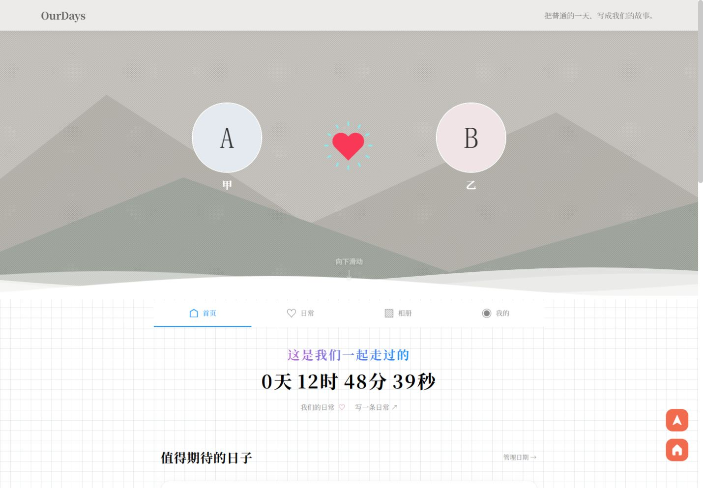

# OurDays／我们的日常

两个人一起记录、整理和回看日常的小网站。保留白色卡片、网格背景与简洁文字，适配手机和电脑。

基于 [LikeGirl](https://github.com/Cleanwn/LikeGirl) 二次开发，由 YuleRider 持续维护。



[查看手机月份回顾预览](screenshots/recap-mobile.jpg)（虚构记录与中性素材）

## 可以做什么

- 图文日常：补记日期、九图排序、跨设备草稿、喜欢和回应、站内消息。
- 共同回忆：主题故事、回忆月历、往年今日、月份照片拼图。
- 日常陪伴：公历纪念日与生日倒计时、共同清单、可选记录灵感。
- 原有小记、相册、礼物墙和留言板，支持双方管理可见范围。
- 私密图片存放在网站目录外；作者可恢复七天内删除的日常和移除的照片。

## 安装

环境：PHP 7.4+、MySQL 5.7+，PHP 扩展 `mysqli`、`gd`、`exif`、`curl`。GD 需支持 JPEG、PNG、WebP。已使用 PHP 8.3 / MySQL 5.7 验证；原后台兼容性需随 PHP 版本核对。

1. 下载源码，为项目建立一个**空数据库**及专用数据库账号。
2. 复制 `config/app.example.php` 为 `config/app.php`，填写数据库信息和实际站点地址。真实配置不能提交到 Git。
3. 在项目根目录运行：

   ```bash
   php tools/install.php
   ```

   安装会创建两人账号 `couple_a`、`couple_b`，并显示各自的随机密码及后台安全码。请私下保存；数据库非空时安装会停止。

4. 将网站运行目录设为项目的 **`public/`**，开启 HTTPS；可参考 `tools/nginx.conf.example`，PHP-FPM 地址按服务器调整。
5. PHP 运行用户需要读取 `config/app.php` 并读写 `var/`；维护账号需要写入 `backups/`。这些目录不要放入其他公开网站目录。建议配置文件权限 `600`、私有目录 `700`。
6. PHP 设置建议：`upload_max_filesize=10M`、`post_max_size=12M`、`memory_limit=256M`。在后台填写你们的昵称、头像和相伴日期。

## 可选设置

- QQ 昵称查询使用天行数据的 QQ 查询接口，在私有配置中填写自己的 `qq_api_key`。不填也可手动填写昵称。查询保留缓存和额度限制。
- 目前只支持公历生日；照片支持 JPEG、PNG、WebP，单张原图最多 10MB。
- 图片、私密响应不使用公开缓存，外部图床的原链接不受本站访问权限控制。

## 备份与恢复检查

安装 MySQL 命令行工具及 `tar`，确保工具在维护账号的 PATH 内：

```bash
bash tools/run-maintenance.sh backup
bash tools/run-maintenance.sh restore-check /path/to/OurDays/backups/BACKUP_NAME /private/mysql-admin.cnf
bash tools/run-maintenance.sh cleanup
```

恢复检查使用临时数据库，需要管理员配置具备创建和删除临时库的权限，不覆盖正在使用的数据库。备份包含真实配置和私密内容，必须私下保存。

可通过服务器计划任务每天执行备份及清理；备份目录默认不自动删除，保留周期由站长设置。服务器 PHP 命令不在 PATH 时，可设置 `PHP_CLI=/path/to/php` 再运行启动脚本。

## 许可

沿用仓库中的 GNU AGPL-3.0 许可证，保留上游及第三方的必要版权与许可声明。原项目作者 Ki；OurDays 新增与修改部分由 YuleRider 维护（2026 年）。联网部署时应向使用者提供相应版本的源码获取入口。

本仓库不包含站长的真实照片、账号、数据库或接口密钥。演示截图只使用虚构记录与中性素材。
